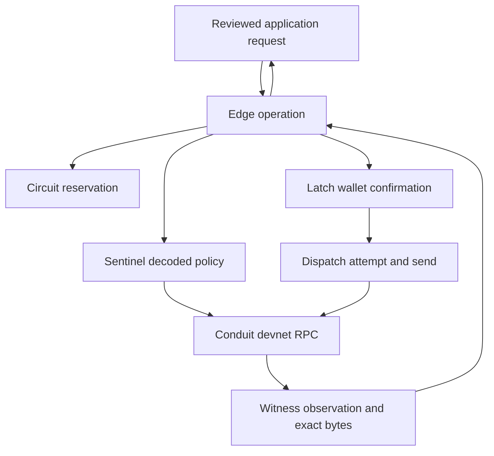

# Solana Lab architecture

Solana Lab is a standalone web application consuming eleven reusable Solana Sidecars and the independent Market Pulse Sidecar. Its shipped browser runtimes and its installed Sidecars expose the same application API. UI actions, receipts and Local AI inspection all go through declared tools.

| Layer | Responsibility |
|---|---|
| `src/catalog.mjs` | Component descriptions, Guide articles and separate devnet/recovery profiles |
| `src/runtime.mjs` | Declared methods, installed owning-shell discovery, standalone runtime bootstrap |
| `src/lab.mjs` | Saved application operations, treasury workflow, simulated position lifecycle and evidence links |
| `src/workflows.mjs` | Durable service orders, independent payout children, receipt-gated delivery and document comparisons |
| `src/capability-lab.mjs` / `src/capability-ui.mjs` | Exact SPL transfers, immutable payment requests, independent verification and bounded address reads |
| `src/setup-readiness.mjs` | Public policy and foreground observation projection; never grants authority |
| `src/guide-catalog.mjs` | Shared page defaults, named Assistant offers and reset availability for twelve demos |
| `src/showcase-ui.mjs` | Connected recipe pages, landing and developer docs |
| `src/architecture.js` / `src/solana-client.mjs` | Hash-checked shared cApp explorer and thin client |
| `src/guided-content.mjs` / `src/guided-actions.mjs` / `src/guided.mjs` | Source-authored workflows, product action/postcondition boundary and Guide integration |
| `src/guide-docset.js` | Additive public Guide articles; no modification of immutable tours |
| `src/app.mjs` | Visible review, wallet, activity and receipt controls |
| `src/wallets.mjs` / `src/wallet-tools.mjs` | Direct private wallet API calls, public receive QR, scoped local history and session-only backup file comparison |
| `src/assistant.mjs` | Optional Local AI with bounded read tools; no signing/submission authority |
| `runtime/` | Vendored canonical Sidecars, checked against `sources.json` before building |
| `tools/configure-capp.mjs` | Explicit, backed-up merge into the existing cApp project settings |

## Market data

`sidecars/market-pulse/core.mjs` owns provider requests, quota backoff, scoped history and timestamped marks. `chart.mjs` adapts the supplied SYNTH canvas renderer. `panel.mjs` owns its collapsible UI in a ShadowRoot. `src/market.mjs` shares an installed `capp.market.pulse` instance or creates the same bundled implementation. Both chart and Position Studio acquire the same feed.

Price requests start only with a consumer and stop in the background or when released. The app persists a position action’s observed price before calling its first Sidecar, includes it in the message digest and evidence, and reuses it during recovery. P&L is a simulated long position with no leverage, fees or slippage. Existing fixed-price records keep their old basis.

Market Pulse has no dependency on Edge or the Solana components. The feed supports Jupiter observations, an HTTP OHLCV contract and app-supplied packets. Its three Lab assistant tools only read status, quotes and candles.

## Transaction path

Circuit reserves the operation before effects. Edge builds a canonical legacy SOL transfer using bundled official Solana codecs. Sentinel verifies its sender, recipient, amount, instruction set and simulation. Latch signs after confirmation, and Edge verifies the signature. Dispatch records the signed bytes and signature before sending. On a lost reply, Witness observes that signature; it never constructs another transaction.

Treasury adds Accord's local two-of-three reviewer demonstration before Latch. Those names are not authenticated people and the quorum is not a threshold signature. The wallet approval remains a separate decision.

## Simulated venues and evidence

Positions use Compass, Sentinel, Circuit, Switchyard, Arena and Witness without asking a wallet to sign a synthetic position. Arena is the only venue effect. Allocation and lifecycle records do not move funds. A closed position releases its bucket only after simulated sweep evidence.

`arena.evidenceTransfer()` hashes the stored outcome and an explicitly chosen nominal SOL amount. Its integer divisor defaults to 10,000. The app persists a link from one Arena action to one evidence payment before preparation can fail. Retries resume the same payment. A separate Edge transaction transfers the scaled amount and commits the digest in a memo. The receipt preserves the simulation and devnet facts separately. There is no Jupiter devnet adapter or fabricated swap result.

## Runtime and state boundaries

The installed app discovers the owning same-origin shell only when app identity and the shell's exact `appFrame` match. A missing installed API produces a named setup error; browser providers never replace it silently. A standalone web page loads the vendored runtimes. No runtime SDK download or developer service is required for the direct RPC path.

Recovery uses an isolated, no-network demo profile and private MessagePort. The Network page uses the primary Conduit through its bounded inspect API. Conduit owns the settings dialog, endpoint-specific client-token attachment and optional second read-only connection. It has no public programmatic configuration mutation API. Runtime editing preserves the compiled payment network and write permissions. Main payment RPC verifies devnet genesis, uses bounded timeouts/rates and exposes its configured endpoint as client data.

Lab state and Sidecar ledgers are separate, scoped local records. Web Locks coordinate cooperating contexts where available; this is not a distributed datastore or a hostile-page security boundary. Export before clearing data. Latch owns persistent device wallets: devnet keys are plaintext, mainnet keys password encrypted. The optional temporary wallet remains process-local. Existing external/native wallet providers remain separate adapters requiring their own acceptance. Wallet secrets bypass Lab activity/evidence logging; receive QR and history use public data only. Backup comparison retains a digest in session memory and makes no restore/password claim.

The full cApp source contains the canonical runtime implementation, schemas, dependency declarations, generator and source tests. The Lab vendor command copies those runtimes and updates the digest ledger. A normal Lab build verifies the ledger and copies only the static application closure into `dist`.

Latch owns its read-only signing-policy status. Lab owns the setup presentation, input selection and snapshot freshness. Native builds obtain this status from the installed owner; older Latch builds leave unavailable permissions unknown. Explicit Check setup reads and records public fields only. Exact token accounts, fee and rent remain Edge/Sentinel preparation responsibilities.

Lab approval and submission call `requirePaymentAction` after `run()` acquires the workspace lock and reloads saved state. CapabilityLab checks the paid-request claim there. A stale or queued window cannot sign or send after another cooperating window persists verification. Reconciliation uses the separate runtime guard and remains available. Web Locks coordinate cooperating same-origin contexts; local storage is not a remote merchant claim service, and hosts without Web Locks cannot promise atomic cross-window coordination.

The recovery host can replace an injected plan marker only in its explicitly owned `runtime/host.html` iframe after the private port handshake. Existing Sidecar APIs and the actual installed app/shell are never replaced. Earlier Lab records retain their original mode; incompatible records are export-only and cannot call the current payment runtime.

## Connected service records

`ShowcaseLab` extends the existing controller without changing its storage key. Older records gain an empty workflow list in memory. Corrupt lists fail without overwriting saved bytes. Orders save a parent ID, sender and all child IDs before calling Edge. A child retains its intended amount, recipient and commitment; mismatches stop preparation.

Receipt-gated delivery checks the exact Edge/Witness result against the saved payment and order. The service artifact and its digest are saved before a deduplicated Witness application-evidence append. Lost acknowledgements can resume the same delivery. This is local orchestration, not a production merchant security boundary: a remote service must independently verify chain evidence and durable one-time fulfilment.

Payout batches are a collection of independent reviewed transfers. They are not atomic and do not auto-sign or auto-send. Each child memo has an operation binding; two identical payouts in the same blockhash window remain distinguishable. A terminal failed/expired child is not automatically replaced.

Proof studio hashes exact UTF-8 text and uses Edge's application commitment, separate from Arena scaling. Linking a delivered report saves a second workflow; the user still approves its new payment. Only the digest, namespace and operation binding enter the memo.

The static landing, component map and developer docs remain accessible if installed provider bootstrap fails. Operational pages fail closed; no browser replacement runtime is created. Shared authored data is in cApp's `sidecars/solana-edge/docs/experience/`, generated there and explicitly vendored here.

See the [current architecture review](validation/GUIDE_AI_ARCHITECTURE_2026-09-23.md) and [guided workflow contract](GUIDED_WORKFLOWS.md).

## Guided transaction checkpoints

Guide owns generic user-confirmed action progress; `guided-transactions.mjs` owns Lab phases and receipt postconditions. Each temporary checkpoint binds the displayed operation and next action. A replay, restart or changed saved state first refreshes the review. Signing, sending, preparation and reviewer actions recheck expected state inside the workspace lock. Pending/lost responses only observe the retained attempt. Batch completion requires every child’s bound receipt; service proofs remain linked to their original report. No additional Sidecar is introduced.
