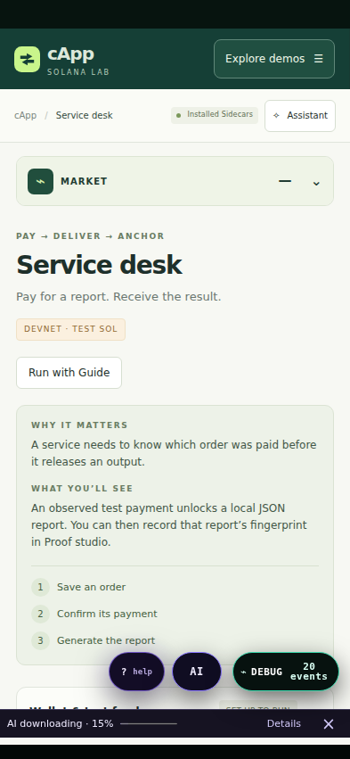
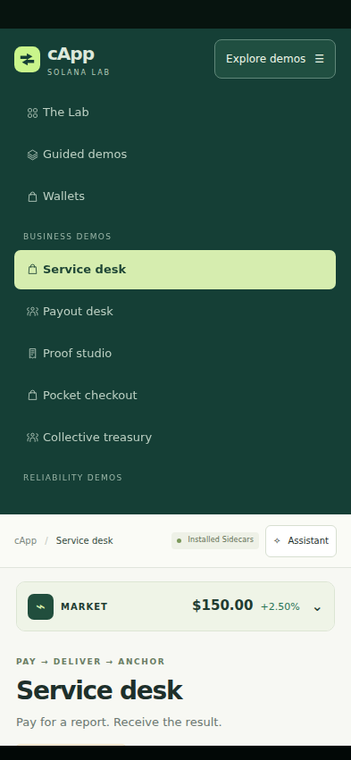
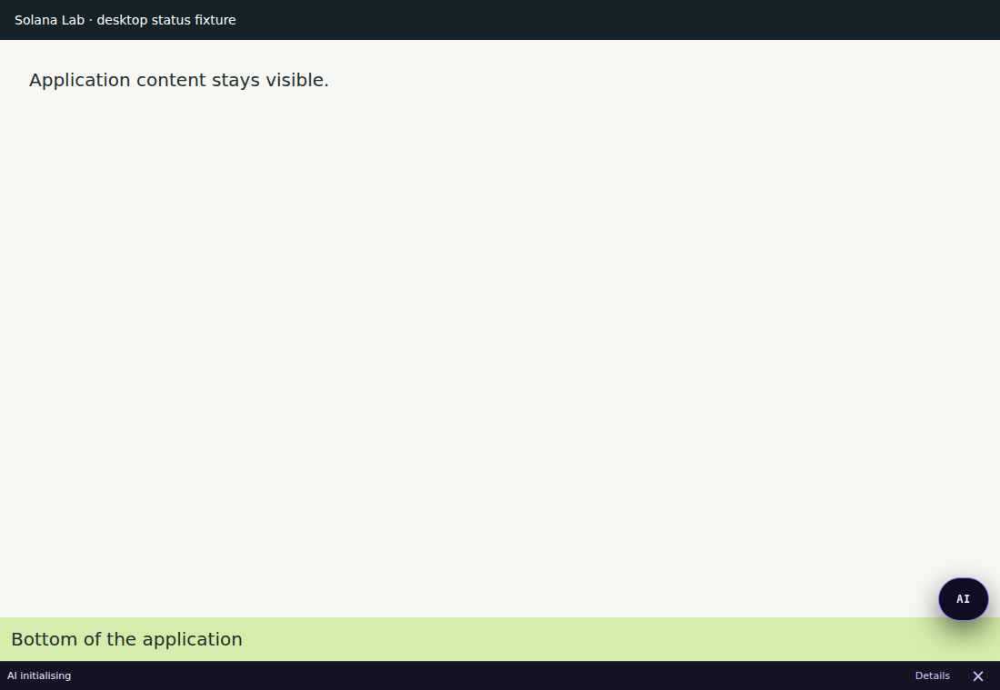

# Mobile sweep and compact AI progress — Lab 0.7.9

Updated from `colosseum(20260928-125615-173).zip` only.
Source SHA-256: `d23142eec1c15a76b27868d6125e0a34ae835fba00e27f3db4818d468aaeabda`.

## Findings and changes

- The Android report listed all eleven Solana APIs as unavailable before their scripts had reached activation. Optional Links, Local AI and Market Pulse activation waits delayed them past the Lab's initial connection deadline. The cApp loader now observes each compiled readiness contract before injection and waits for independent activations concurrently. Loading remains ordered and bounded. Late readiness repairs diagnostics and reconnects the Lab without replacing installed providers.
- Local AI service readiness no longer waits for baseline model download/loading. Inference still requires a loaded model. Downloading and initialising now use one dismissible, 32-pixel status line below the application. Both Android and Windows styles reserve this space; Details opens AI settings. Dismissal does not cancel the download. Native and baseline callbacks share the same notice.
- Mobile Links hides the strip with only the app tab and restores it for extra tabs. Desktop keeps its strip. App fields persist across tab changes.
- Android no longer forces its dark window background onto authored app content. The Lab keeps its light canvas. Mobile navigation now exposes every page through Explore demos; long documentation and narrow layouts stay within the viewport.
- Guide, AI and Debug shortcuts share a bottom row within the Android surface bounds. Other shortcuts are suppressed during a Guide walkthrough or full panel, so Debug no longer intercepts Guide's Done button.
- Updated Guide help, setup documentation and generated web assets. No changes to wallet authority, transaction terms or selected project configuration are required for these fixes.

## Verification completed

| Check | Result and scope |
| --- | --- |
| Android startup harness | 3 passed: declared/synchronous events, ordered injection without activation blocking, identity checks, late recovery and genuine failure reporting. |
| Generated Android + Windows browser harness | 9 passed. All 16 Android components activate during a model download; 26 demo/docs paths fit a 393px phone; 320px and landscape layouts remain bounded; tabs preserve an actual mint field; guided checkout reaches a devnet receipt; delayed startup recovers automatically. Windows uses its actual generated adapter, shared runtime and Windows stylesheet. Its status row reserves space, switches to initialising, opens Details and returns space on dismissal. |
| Guide transaction browser suite | 11 passed, 16 fixture sends: explicit approval boundary, treasury, five-child payouts and resume, service-to-proof, tokens, requests, expiry and lost replies. |
| Links browser regression | 23 passed, including app frames, native-tab command boundaries, preserved state, file readers, the current Lab's developer links and responsive bounds. |
| Lab UI and host suites | 25 UI + 5 host checks passed. Installed-runtime suite: 11 passed. Preview suite: 5 passed; 27 routes generated. |
| Package/build checks | Android builder, artifact verification, controls/theme, document-start safe area, global/automatic surface guards, Debug and Local AI packages, Links package, and Windows Local AI/MCP/Guide scaffold checks passed. |
| Generated asset checks | Links build current; Guide projection current (77 articles, 26 workflows); Guide/Market/Solana ledgers verified during Lab build. |

These are source, generated-package and Chromium checks with controlled native-command/RPC fixtures. They do not establish Android JNI/Gradle build success, native child-WebView geometry, hardware insets/keyboard behaviour, a real model download or GPU inference, or live devnet payment success. Install the rebuilt app and follow [MOBILE.md](../MOBILE.md) for device acceptance. No real funds were moved and nothing was published.

## Captured layouts

Android downloading, with the app ending above the status line:

Expanded mobile navigation:

Windows generated Local AI package in a desktop app-frame fixture:

