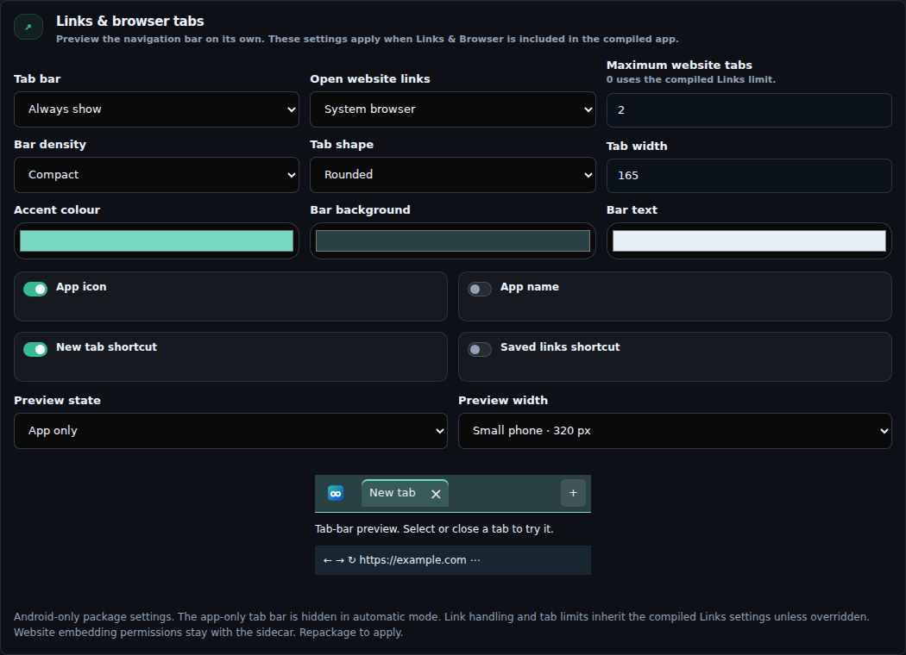
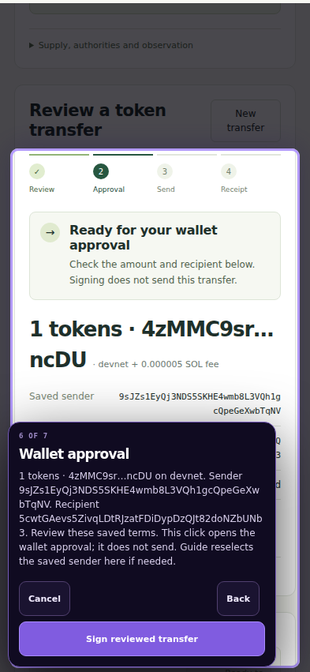

# Wallet setup and Android Links — 28 September 2026

Input: `colosseum(20260928-153659-162).zip` (SHA-256 `007f5c9e0496936231d2d55ffe9cb765602190bba2d15983d1e7354450a52635`).

Result: Lab 0.7.10, Guide 1.4.6 / revision 15, Links 0.4.1-alpha.1.

## Changes

- Shared, serialized Guide wallet setup reuses a selected wallet, prefers an observed funded saved payer when none is selected, and creates a missing devnet device payer on the setup action. Creation uses Latch directly; private key material never enters Lab event logs or Guide results.
- Token and request receiver steps complete setup in place on their named click. Retries reuse the same wallets; a new receiver does not switch the payer.
- SOL preparation stays at a funding checkpoint when needed. Token setup separately checks SOL and the exact token account; the existing optional Links/Guide faucet companion carries the payer address. A faucet's human verification is not automated.
- Checkout, treasury, service, payouts, proof, optional position evidence, asset inspection and blank devnet activity queries share wallet setup. Explicit public addresses and simulations do not create wallets. Explicit external-wallet draft addresses retain the existing preparation path.
- Saved transaction senders are reselected only if that wallet exists. A missing original key requires restoration. Selecting a sender invalidates the old Guide transaction checkpoint. Signing, sending, receipt observation and request verification stay separate.
- Android Build adds automatic/always tab visibility, link destination, inherited/bounded tab limits, density, shape, width, colours and optional shortcuts. The live preview renders only navigation using the same bar renderer as the installed Android owner. Native views and app viewport bounds use the actual bar height. Desktop behaviour stays intact.
- Source Guide content was published as a new immutable project release using cApp's publisher. Older releases, compiled history, source references, RPC settings, token permissions, Local AI selections and saved build profiles remain unchanged. No new sidecar was needed.

## Verification

Passed `npm run test:guided` (82 named checks), payment setup (5), token setup (9), the new fresh-wallet mobile browser walkthrough (3), Android Links browser checks (5), Windows chrome browser checks (16), Android Build normalization/renderer parity, Android controls/theme, Links selected/unselected package closure, Android scaffold generation and project Guide build binding. Re-ran the affected fresh-wallet and guided-action checks after preserving the explicit external-wallet draft path.

The mobile walkthrough began with zero wallets, created payer and receiver, paused separately for fixture SOL and USDC, prepared one transfer, then required separate signing and sending clicks and verified its receipt. One fixture transfer was sent; no live funds or faucet claims were used. Android browser checks verify tab geometry and state retention with controlled native commands. Both Lab distribution and public preview were regenerated.

`android_links_config_smoke.py` checks Python/JavaScript preference parity and confirms that normalization does not alter compiled Links permissions or select an absent sidecar. Source/project manifests and the selected Guide release hash match. Historical immutable releases and unrelated project fields were compared with the input archive.

This environment did not compile/run a real AAB or JNI library, exercise a physical Android WebView, download a real GGUF, claim faucet funds or submit a live Solana transaction. Install the rebuilt AAB as an update with the same package/signing key; do not uninstall or clear data if retaining models/wallets.

## Screenshots

